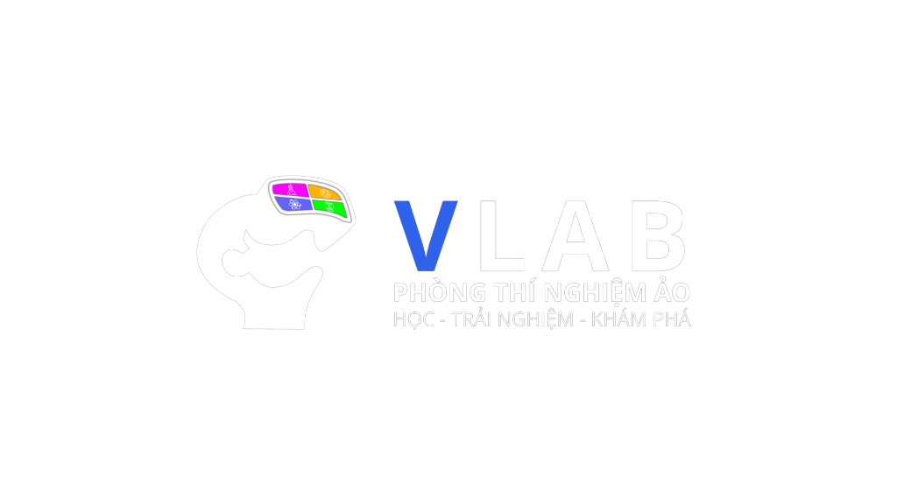

# VLAB — Virtual Laboratory

<p align="center">
  
</p>

**Unity 6000.6.4f1 · Cấu hình Android 8.0+ · ARMv7 / ARM64 · Nội dung học ngoại tuyến**

[Cài APK](#chơi-trên-android--không-cần-cài-unity) · [Mở project Unity](#mở-và-phát-triển-mã-nguồn) · [Tài liệu](docs/README.md) · [Nhật ký thay đổi](CHANGELOG.md)

> **Trạng thái 26/10/2026:** bản thử nghiệm **0.1.19/code40** có thao tác giữ/kéo bình rửa để thêm nước ban đầu trong C05; bảo toàn lượng nước và chất tan, lưu phần đã thêm. [Bằng chứng và phạm vi còn thiếu](docs/ManualWater/REPORT.md). Chưa có rót hóa chất tự do cho mọi bài hoặc nghiệm thu phần cứng thật.


<p align="center">
Virtual Laboratory là nền tảng phòng thí nghiệm thực tế ảo (VR) được phát triển nhằm phổ cập giáo dục STEM thông qua trải nghiệm thực hành trực quan, an toàn và chi phí thấp.
</p>

<p align="center">


</p>

---

## Giới thiệu

VLAB (Virtual Laboratory) là giải pháp phòng thí nghiệm thực tế ảo được xây dựng nhằm giải quyết tình trạng thiếu điều kiện thực hành STEM tại nhiều trường học, đặc biệt ở khu vực miền núi, vùng sâu, vùng xa và những nơi còn hạn chế về cơ sở vật chất.

Thay vì đầu tư các phòng thí nghiệm truyền thống với chi phí lớn, VLAB tận dụng điện thoại thông minh, kính VR giá rẻ và bộ điều khiển tương tác sử dụng ESP32 để mang đến trải nghiệm thực hành nhập vai ngay trong môi trường thực tế ảo.

Người học không chỉ quan sát mà còn trực tiếp thao tác với các dụng cụ, mô hình và thí nghiệm giống như trong phòng thí nghiệm thật, từ đó nâng cao khả năng tiếp cận giáo dục STEM một cách trực quan, an toàn và hiệu quả.

---

## Vấn đề

Trong quá trình khảo sát thực tế tại nhiều trường THPT trên địa bàn tỉnh Cao Bằng, nhóm nhận thấy:

- Thiếu phòng thí nghiệm STEM.
- Thiếu thiết bị thực hành.
- Chi phí đầu tư cao.
- Một số thí nghiệm tiềm ẩn rủi ro mất an toàn.
- Nhiều học sinh chỉ được quan sát thay vì trực tiếp thực hành.
- Học sinh có nhu cầu trải nghiệm công nghệ VR nhưng rất ít cơ hội tiếp cận.

Trong khi đó, phần lớn học sinh hiện nay đều đã sở hữu điện thoại thông minh có khả năng đáp ứng nhu cầu học tập bằng công nghệ thực tế ảo.

---

## Giải pháp

VLAB xây dựng một hệ thống phòng thí nghiệm thực tế ảo dựa trên ba thành phần chính:

- Ứng dụng VR phát triển bằng Unity.
- Bộ điều khiển tương tác ESP32.
- Điện thoại thông minh kết hợp kính VR.

Ứng dụng có chế độ màn hình điện thoại và chế độ Google Cardboard. Hướng nhìn trong kính lấy từ cảm biến của điện thoại. Tay cầm ESP32/BLE thuộc kiến trúc phần cứng của dự án; không mặc định mọi tay cầm BLE đều tương thích với prototype. Tích hợp HID, gán nút và phần còn cần kiểm chứng được ghi trong [tài liệu tay cầm](docs/CONTROLLER_CONNECTION.md).

---

## Mục tiêu

VLAB hướng tới việc xây dựng một nền tảng phòng thí nghiệm ảo có khả năng:

- Phổ cập giáo dục STEM.
- Giảm chi phí triển khai.
- Tăng cơ hội thực hành.
- Đảm bảo an toàn cho học sinh.
- Dễ dàng mở rộng thêm nhiều bài học trong tương lai.

---

## Giá trị cốt lõi

- Tiếp cận
- Trực quan
- An toàn
- Chi phí thấp
- Khả năng mở rộng

---

## Đối tượng sử dụng

- Học sinh THPT
- Giáo viên
- Nhà trường
- Các chương trình giáo dục STEM

---

## Công nghệ

### Software

- Unity
- C#
- Unity XR
- Android

### Embedded

- ESP32
- Cảm biến IMU (tùy phiên bản phần cứng; MPU9250 trong thiết kế cũ)
- Bluetooth Low Energy (BLE)
- ESP-NOW

---

## Cài đặt & sử dụng

### Chơi trên Android — không cần cài Unity

1. [Tải APK VLAB 0.1.19 / code40](https://github.com/thieen209/VLAB/releases/download/v0.1.19-manual-water-code40/VLAB-0.1.19-manual-water-code40.apk). Xem [SHA256 và cấu hình](docs/ManualWater/ARTIFACT.json) để đối chiếu. APK mới nằm trên Releases; code29 cũ được giữ trong Git LFS. File Source code (zip) là mã nguồn để mở bằng Unity.
2. Mở APK trên điện thoại. Nếu Android yêu cầu, cho phép **Cài ứng dụng không rõ nguồn gốc** cho trình duyệt hoặc ứng dụng quản lý tệp đang dùng, rồi xác nhận cài đặt. Có thể tắt quyền này sau khi cài xong.
3. Mở ứng dụng **VLAB**, dùng máy theo chiều ngang và chọn phòng thí nghiệm. Nội dung học và tiến độ được lưu trên thiết bị; chơi không cần tài khoản hay mạng.
4. Có thể chơi bằng màn hình cảm ứng. Để dùng kính, chọn **Vào VR** hoặc chế độ kính trong Cài đặt → Điều khiển, sau đó lắp điện thoại vào kính Cardboard phù hợp. Điện thoại cần cảm biến hỗ trợ head tracking; có màn hình Android không đồng nghĩa chắc chắn hỗ trợ VR. Quét QR của kính trong phần Điều khiển để cấu hình kính khi cần.

**Phân biệt phiên bản:** bản mới là **0.1.19/code40**. Các số code cũ trong biên bản là lịch sử. Xem [báo cáo và giới hạn kiểm thử](docs/ManualWater/REPORT.md).

Cập nhật đè bằng APK có **cùng chữ ký** để giữ tiến độ. Nếu báo xung đột chữ ký, đừng gỡ ứng dụng hoặc xóa dữ liệu chỉ để cài tiếp: việc đó có thể làm mất sổ tay và kết quả đang lưu. APK tự build bằng debug key không thể cập nhật đè bản phát hành dùng chữ ký khác.

### Mở và phát triển mã nguồn

| Thành phần | Yêu cầu |
|---|---|
| Unity Editor | **6000.6.4f1**, đúng với `ProjectSettings/ProjectVersion.txt` |
| Unity Hub | Cài và mở đúng phiên bản Editor; Windows là môi trường đã dùng cho dự án |
| Build Android | Module Android Build Support, Android SDK & NDK Tools và OpenJDK của phiên bản Editor trên |
| Git | Clone repository; cũng cần để Unity lấy package Cardboard từ GitHub |
| Kết nối mạng | Cần cho lần tải Editor/package và kích hoạt Unity; không bắt buộc cho nội dung học sau khi cài APK |
| Thiết bị VR | Điện thoại Android tương thích cảm biến + kính Cardboard; không bắt buộc cho chế độ cảm ứng |

#### 1. Tải source code

```bash
git clone https://github.com/thieen209/VLAB.git
cd VLAB
```

Hoặc chọn **Code → Download ZIP** trên GitHub rồi giải nén. Không đưa `/tree/main` vào lệnh clone, không giữ dấu `< >`, và không tạo một Unity Project mới để chép Assets vào.

#### 2. Mở đúng thư mục bằng Unity Hub

Chọn **Add → Add project from disk**, trỏ tới thư mục vừa clone/giải nén chứa đồng thời:

```text
VLAB/
├── Assets/
├── Packages/
├── ProjectSettings/
├── docs/
├── Evidence/
├── LICENSE
└── README.md
```

Mở bằng **6000.6.4f1** và chờ Unity import xong. `Library`, `Temp` và các tệp IDE được Unity sinh lại nên không nằm trong Git. Không đổi sang bản Unity mới nhất chỉ để mở project.

#### 3. Chạy prototype

1. Mở scene **`Assets/VLABProduct/Scenes/VLAB_Boot.unity`**.
2. Nhấn **Play** trong Editor.
3. Chọn một trong bốn phòng: **Vật lí, Hóa học, Sinh học, Kỹ thuật**. Danh mục có **32 bài**, tám bài mỗi phòng.
4. Dùng chuột để chọn; giữ chuột phải ở nền phòng để nhìn. Chế độ mô phỏng VR trong Editor phục vụ kiểm tra giao diện, không chứng minh cảm biến điện thoại hoạt động.

Scene khởi động cũ `Assets/VLAB/MainMenu/Scenes/Menu.unity` và phím mô phỏng của bản tháng 9 không áp dụng cho mã nguồn hiện tại.

#### 4. Build APK phát triển

Cài các module Android ở bảng trên. Có thể dùng **Build Profiles → Android** trong Editor và build các scene đã cấu hình trong `ProjectSettings/EditorBuildSettings.asset`; scene **VLAB_Boot** đứng đầu.

Dự án cũng có hàm build development sẵn. Đóng Editor đang giữ project, rồi chạy từ thư mục repository, thay đường dẫn Editor đúng trên máy:

```powershell
& 'C:\Program Files\Unity\Hub\Editor\6000.6.4f1\Editor\Unity.exe' `
  -batchmode -buildTarget Android -projectPath (Get-Location).Path `
  -executeMethod VlabProductBuild.AndroidDevelopment `
  -logFile android-development.log
```

APK xuất tại **`Builds/Android/NguaManVLAB-development.apk`**; tên hiển thị khi cài là **VLAB**. Đây là tên tệp của hàm build hiện có, không phải tên ứng dụng. Cấu hình trong Git dùng chữ ký debug mặc định để người clone có thể build mà không cần khóa phát hành của nhóm. Khóa riêng và mật khẩu không được commit. APK code29 được lưu riêng bằng Git LFS trong `releases/android/`.

### Trạng thái kiểm thử

Code33: [Giao diện, preview, theme, hướng dẫn và giới hạn](docs/DesignUpgrade/HANDOFF.md). Các số liệu dưới đây thuộc các phiên trước, được giữ để tra cứu lịch sử.

Đợt sửa source gần nhất có **38 kiểm tra tương tác, 36 kiểm tra hộp thoại và 24 kiểm tra bảng kính hiển vi** đạt trong Editor. Đợt kiểm tra PDF riêng ghi nhận **135 PASS**. Bảng kính hiển vi giữ ảnh khi chọn mẫu, hiện đủ nhãn phân loại và hiển thị lại lớp thành tế bào B02 từ asset gốc.

Các lượt Editor qua nhiều checkpoint đã ghi nhận **32/32 bài có kết quả lưu và mở lại**; một số bước chuẩn bị có hỗ trợ. Đây chưa phải một lượt hồi quy đủ 32 bài trên cùng source cuối, cũng chưa xác nhận thao tác độc lập, độ chính xác khoa học hay thiết bị thật. Biên bản lỗi cũ vẫn được giữ cùng kết quả kiểm tra lại. [Biên bản, ảnh và giới hạn](docs/QA/2026-10-23/README.md). APK code29 đã build thành công; chưa thực hiện lượt kiểm thử đủ 32 bài trên chính APK này.

Code21 đã được build và cài cập nhật trên giả lập Android; có kiểm tra opacity, khởi động lại, giữ dữ liệu cũ và vào stereo ở P01/C04/B01/M01. Điều đó không đồng nghĩa toàn bộ 32 bài đã vượt qua kiểm thử đầu-cuối trên điện thoại thật.

Các giới hạn về tương tác VR, cảm biến, tay cầm và các lựa chọn Cài đặt được ghi cụ thể trong [báo cáo 0.1.7](docs/QA/Prototype-0.1.7/README.md) và [checklist Cài đặt](docs/QA/Prototype-0.1.7/SETTINGS-LEDGER.md). Tài liệu cũ vẫn được giữ để tra cứu lịch sử, không dùng làm hướng dẫn cài đặt hiện hành.

---

## Định hướng

Prototype hiện có danh mục bài học trong bốn phòng và tiếp tục được phát triển theo các lĩnh vực STEM:

- Physics Lab
- Chemistry Lab
- Biology Lab
- Engineering Lab

---

## Tầm nhìn

Mọi học sinh đều có cơ hội tiếp cận phòng thí nghiệm STEM chất lượng cao, bất kể điều kiện cơ sở vật chất của nhà trường.

Thông qua việc kết hợp công nghệ thực tế ảo, thiết bị nhúng và điện thoại thông minh, VLAB hướng tới xây dựng một hệ sinh thái học tập trực quan, hiện đại và có khả năng triển khai rộng rãi trong giáo dục phổ thông.

---

> **Samsung Solve for Tomorrow 2026**
> **VLAB — Creating Technology for Every Student**
