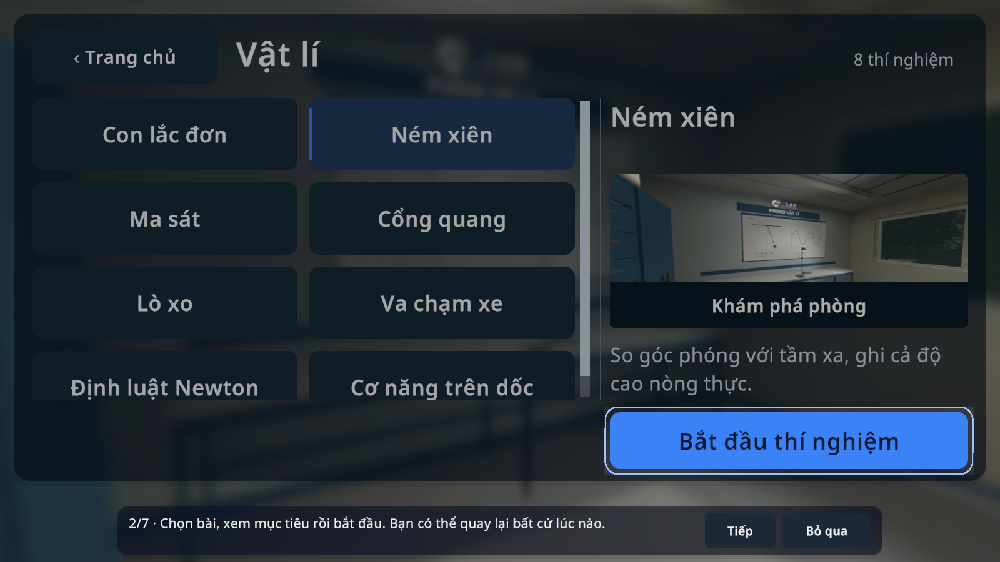
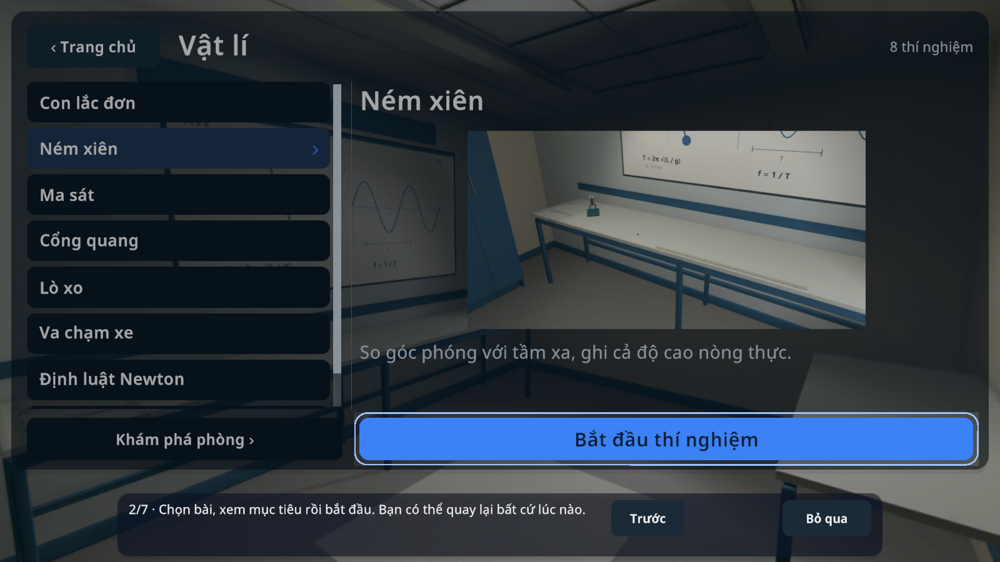
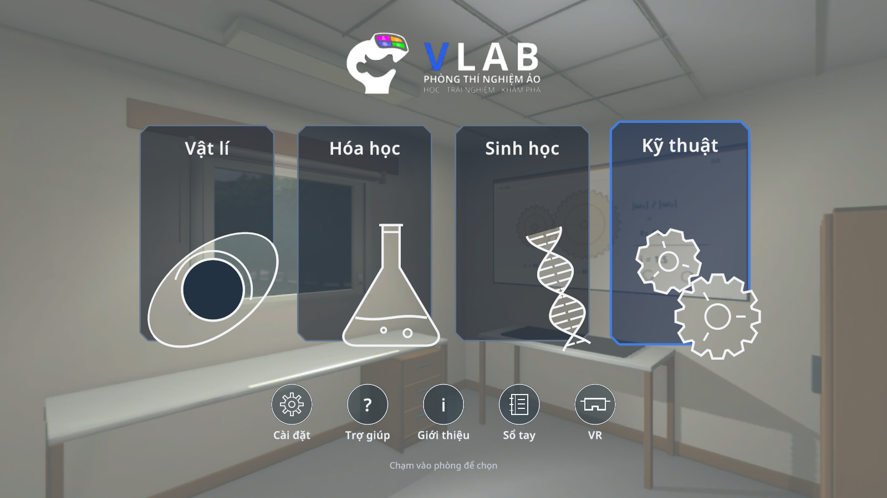
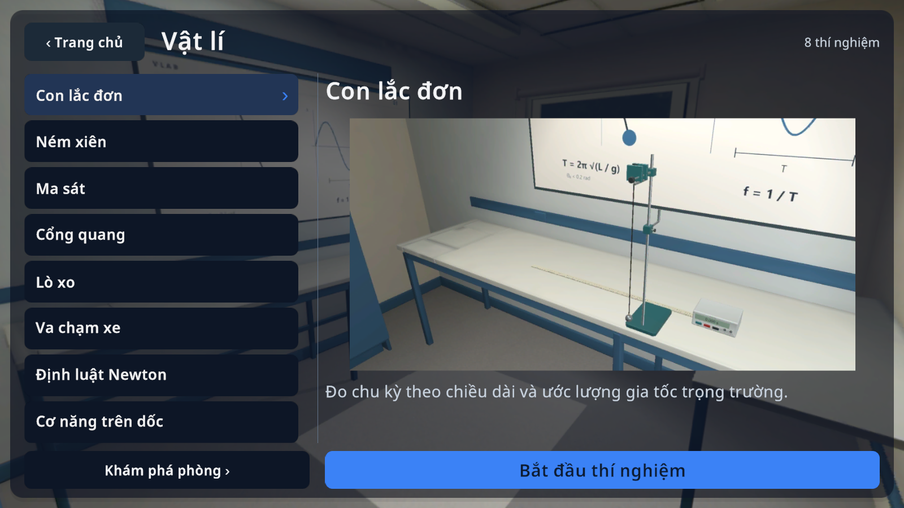
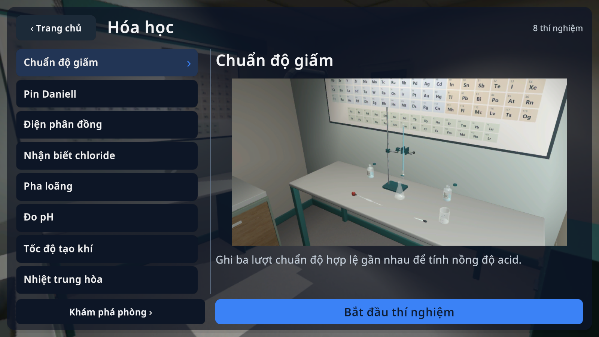
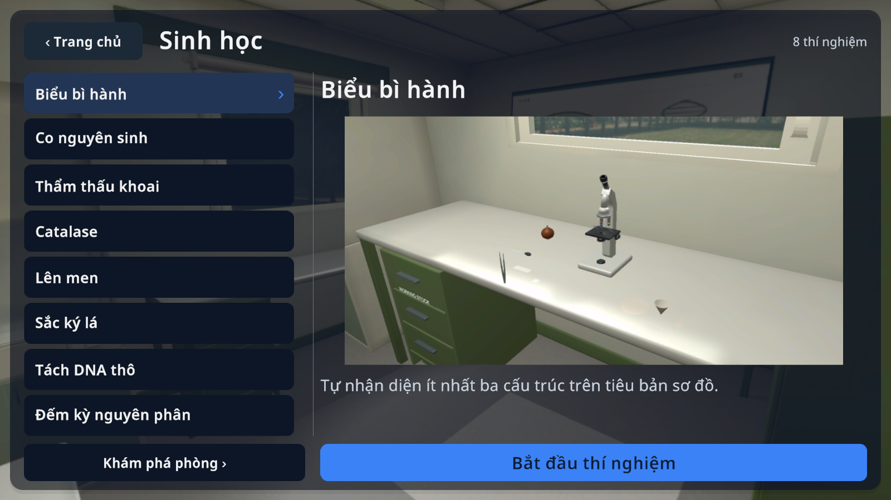
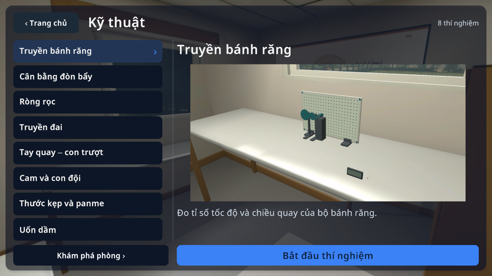

# VLAB 0.1.13 / code33

Bản thử nghiệm Android, dùng source tại commit gắn với tag `v0.1.13-design-code33`. [Tải APK](https://github.com/thieen209/VLAB/releases/download/v0.1.13-design-code33/VLAB-0.1.13-design-code33.apk). [Thông tin file và SHA256](ARTIFACT.json).

## Thay đổi

- **Tối là mặc định** cho hồ sơ mới. Có năm theme: Tối, Sáng, Xám than, Rừng sâu, Xanh biển; lựa chọn và độ trong suốt được lưu. Không ghi đè theme đã chọn hoặc ghi chép của người học.
- Năm nút menu giữ hình tròn, chỉ làm mờ nền trong vòng tròn. Card lấy màu từ theme; nền phòng chụp từ project hiện tại, rõ hơn và cache ngoại tuyến.
- Danh sách tám bài gọn, preview riêng từ bộ dụng cụ thực đang lắp trên bàn của từng bài, một nút bắt đầu chính. Ảnh được dựng/chụp trong Unity; không phải cảnh AI tạo và không render32 camera liên tục. Đây là ảnh fixture, không phải kết quả đo của học sinh.
- Tour chuyển bước khi người dùng thực sự chọn phòng, vào bài, chọn và thao tác dụng cụ; Tiếp chỉ dùng ở các trang thông tin. Có Bỏ qua, xem lại hướng dẫn trước và trở về bước hiện tại. Thanh hướng dẫn được dành chỗ riêng, lớp highlight không chặn thao tác.
- Mức gợi ý Nhẹ / Chi tiết / Tự khám phá có tác dụng và được lưu; giữ hint theo trạng thái thật của bài.
- Độ nét VR Tự động / Tiết kiệm85% / Rõ100% độc lập với chất lượng đồ hoạ phone. Không sửa hệ thống head tracking, hiệu chỉnh cảm biến hay firmware tay cầm.
- Giữ tương tác dụng cụ, công thức/bảng phác thảo, sổ tay, âm thanh theo hành động và32 thí nghiệm hiện có.

## Ảnh thực

Cùng màn chọn Ném xiên khi đang hướng dẫn, canvas1600×900:

| Trước | Sau |
| --- | --- |
|  |  |

| Vật lí | Hoá học |
| --- | --- |
|  |  |
|  |  |

## Kiểm tra trên source cuối

[Biên bản](focused-checks.txt):525 assertion PASS trong lượt chạy cuối; gồm sự kiện chạm qua Unity UI, lựa chọn32 bài và đúng ảnh, bốn kích thước viewport1280×720 /2340×1080 /2048×1536 /1080×2340, safe area lệch/notch, VN/EN/cỡ chữ lớn, tour, cuộn cài đặt, năm theme/lưu mở lại/độ tương phản token, animation/tắt animation, VR simulator/render scale và trở lại phone. Kiểm tra picker/thao tác/nâng-xoay-trả dụng cụ/bảng bài học ở bốn bài đại diện thuộc bốn phòng; input/controller core và mute/âm thanh có kiểm tra hồi quy.

Các lỗi fixture kiểm tra trước đó gồm locator nút Áp dụng cũ và cố bấm tuỳ chọn dưới vùng cuộn. Lượt cuối dùng đúng nút và thao tác cuộn thật. Hai góc ảnh Vật lí ra ngoài phòng được phát hiện bằng xem ảnh và chụp lại; [nguồn ảnh](preview-provenance.txt), [panorama](panorama-capture.txt).

Không chạy lại đầy đủ khoa học32 bài chỉ vì đổi giao diện; phần SDK/thao tác đã kiểm tra ở [code32](../Workbench/HANDOFF.md) là bằng chứng lịch sử riêng. Kết quả mới không phải32 lượt thí nghiệm hoàn chỉnh trên thiết bị thật.

## Phạm vi và giới hạn

Unity6000.6.4f1; cấu hình Android8.0+ / ARMv7 và ARM64. Đối chiếu [kết quả build](android-build.txt) và [chữ ký](apk-signature.txt). APK ký bằng chứng chỉ VLAB hiện có; không đưa APK hoặc khoá ký vào Git.

Chưa có điện thoại, kính Cardboard hoặc tay cầm BLE để xác minh APK cuối, độ trễ/cảm giác nhìn, shader trên GPU di động hay FPS thực tế. Kiểm tra world-space trong Editor là simulator, không chứng nhận theo dõi đầu hoặc tương thích mọi máy. Ảnh preview phản ánh bộ dụng cụ hiện tại; một số chi tiết bố trí/độ đẹp của model vẫn cần người dùng đánh giá, không coi là chứng nhận10/10.
