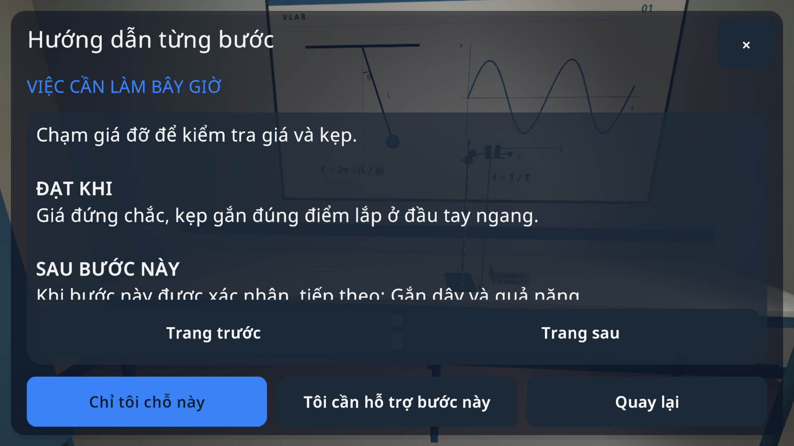

# VLAB 0.1.18 / code39 — khám phá và hướng dẫn

26/10/2026. Goal 17 mục vẫn chưa hoàn tất; đây là bản sửa tiếp sau code38.

## Đã sửa

- Khi chuyển phòng, xóa liên kết tới bộ dụng cụ cũ trước khi kích hoạt cảnh mới. Trước sửa, đối tượng Unity đã bị gỡ vẫn nhận lời gọi qua `?.`, gây `MissingReferenceException` ở `CancelGrab` khi đổi chế độ; đường trở về trình duyệt cũng có thể gọi vào đối tượng cũ. [Bằng chứng trước sửa](experience39-before-explore-fix.txt).
- Luồng khám phá đã được kiểm tra sau dùng dụng cụ/thông số, qua tạm dừng → cài đặt → tiếp tục → trở về, rồi vào lại. Có thao tác chạm điện thoại và tín hiệu tay cầm giả lập chạy qua đường xử lý UI thật. [Kết quả đầy đủ](followup-full-checks.txt). Phòng Physics hiện không có node `Teleport_`; test so với cảnh thật, không tự thêm hoặc nhận là đã kiểm tra nút dịch chuyển.
- Hướng dẫn có việc hiện tại, tiêu chí, bước tiếp theo có điều kiện và phần thực hành từ tài liệu của 32 bài. Một vùng đọc; điện thoại giữ các nút hành động trong chân bảng thay vì lồng nhiều vùng cuộn. Nút Quay lại được kiểm tra bằng sự kiện chạm, không chỉ gọi callback.
- Hướng dẫn BLE sửa thành hai thiết bị `VLAB-Left`/`VLAB-Right`, phân biệt Đã lưu với dữ liệu trực tiếp và nói rõ gán nút dùng chung hai tay.
- Bài học định dạng chỉ số/mũ từ nội dung được soạn; không xử lý ghi chú cá nhân. Các trang công thức dựng sẵn của 32 bài được kiểm tra nguồn, ảnh và bố cục ở hai ngôn ngữ/cỡ chữ.

[Kiểm tra P01 và UI ngay trước build](checks.txt), [kết quả build](android-build.txt), [APK/chữ ký](ARTIFACT.json), [mã nguồn chuẩn hóa xuống dòng](SOURCE_SHA256.json).

## Phần chưa đạt

- Rót tự do **chưa nối vào điều khiển hay bài học**. `LiquidPourTransfer` mới là nền kiểm tra đường rót, vật cản, dung tích và bảo toàn thể tích. Test chỉ xác minh phần nền; không phải PASS trải nghiệm rót. Bình thuốc thử hiện từ chối thay thể tích khi nghiêng. Cần hoàn thiện lưu/hiển thị chất lỏng khi nghiêng, bảo toàn từng chất, lưu trạng thái và nối với thẩm quyền số đo trước khi bật.
- Chưa chạy đủ32 hành trình thí nghiệm qua UI trên APK mới. Kiểm tra trang công thức/hướng dẫn32 bài không thay cho kiểm tra32 thí nghiệm.
- Chưa nghiệm thu điện thoại, cảm biến/Cardboard, âm thanh thực tế hoặc hai tay cầm BLE thật. World UI dùng mock controller; không chứng minh head tracking.
- Đặt dụng cụ vẫn dùng mặt bàn hợp lệ, không phải vật rơi/tràn tự do. Các công thức trong văn bản dài chưa được dàn thành phân số/căn chuẩn ở mọi vị trí; trang Công thức dùng ảnh đã dàn chuẩn.

Các bản log sao chép được bỏ khoảng trắng cuối dòng; log gốc vẫn ở thư mục Evidence của project.
