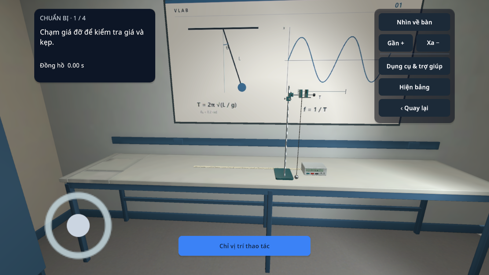
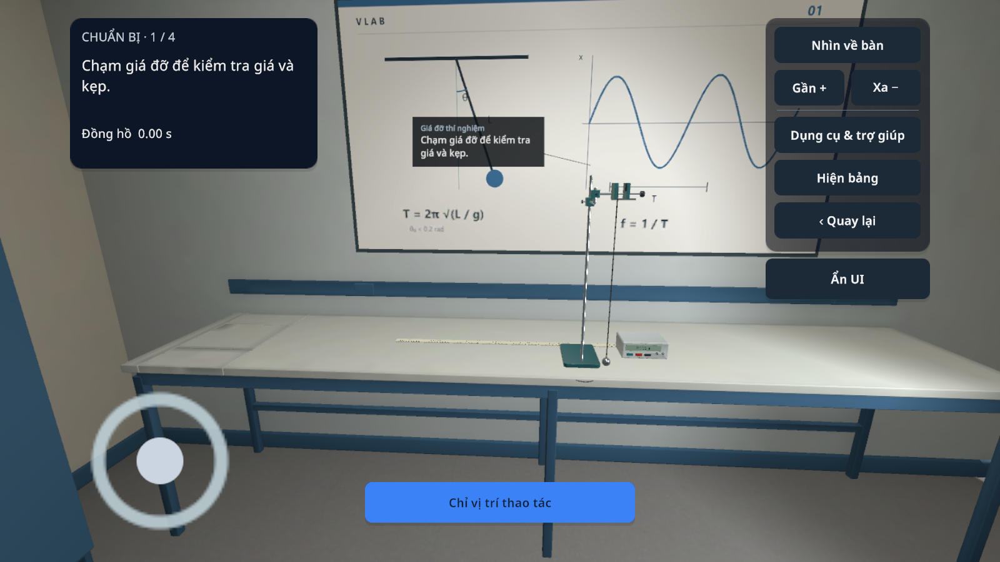
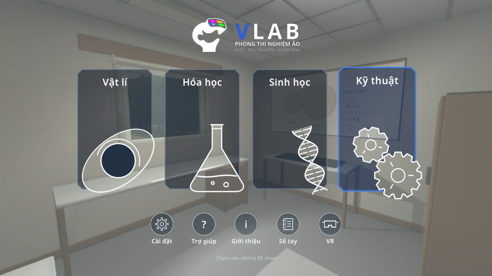

# VLAB 0.1.17 / code38 — sửa trải nghiệm

Ngày: 26/10/2026. Đây là bản thử nghiệm; chưa đóng toàn bộ goal 17 mục.

## Thay đổi đã triển khai

- P01 lắp kẹp vào đúng đầu tay ngang có sẵn của giá đỡ, thay vì trụ đứng. Giữ nguyên model và chiều cao điểm treo; điểm treo cách trụ66mm ngang và133mm theo chiều sâu. Kiểm tra toàn dải chiều dài/góc cho phép và đế nằm trên bàn.

- Camera điện thoại giữ vị trí và góc nhìn khi cập nhật bước, mở/đóng thông số hoặc dụng cụ. Lệnh nhìn về bàn giữ chiều cao mắt. FOV dọc 70–120°, giá trị cũ dưới70 được chuyển lên70 mà giữ hồ sơ.
- Cửa có nút tại cửa, chỉ hiện trong khoảng1,2m. Phải chạm hoàn tất hoặc chọn rõ bằng tay cầm; chạm mô hình cửa và nhìn giữ không mở hộp thoát.
- Dụng cụ phù hợp có thể đặt xuống phần bàn trống tại vị trí đang cầm, giữ tọa độ ngang. Đặt không an toàn được giải thích; nút ×/Quay lại trả về vị trí trước khi cầm. Giá và thiết bị cố định vẫn cố định.
- Gợi ý bám đầu ống nhỏ giọt/bàn kính khi có điểm chuẩn; bỏ giới hạn12 giây của nhãn đang dùng và giới hạn nhãn trong vùng quan sát. Các nút xoay dùng chữ thay ký tự thiếu glyph.
- Kính hiển vi có thao tác trực tiếp cho lam, kẹp, vật kính và lấy nét. B01 cần đặt lam đúng vị trí, đóng kẹp rồi lấy nét10× trước40×.40× khóa chỉnh thô; mở kẹp khóa ghi nhận nhưng giữ các quan sát đã phân loại.
- C04 xuất hiện kết tủa dần trong3 giây mô phỏng hoạt động; tạm dừng giữ trạng thái. Đây là diễn họa định tính, không phải thời gian động học thực nghiệm; đơn vị liều vẫn là đơn vị mô phỏng.
- Vòi nước có nguồn âm tại đầu vòi theo trạng thái mở/đóng, phòng đang hoạt động và âm lượng. Thao tác kẹp có âm thanh cơ cấu.
- Trang BLE phân biệt Trái/Phải, trạng thái trực tiếp/đã lưu và mở phần gán nút chung. Không thay giao thức56 byte.
- Boot VLAB ngắn, tôn trọng giảm chuyển động; dòng ghi công “Made by Ngựa Mán team with love”. Tắt Unity splash/logo trong cấu hình build.

## Bằng chứng lần chạy này

[Kết quả kiểm tra tập trung](checks.txt):42 dòng PASS, gồm các sự kiện chạm qua giao diện vào bài P01, camera, FOV, nút cửa, nhãn gợi ý và gọi các bộ kiểm tra SDK. Các bước dựng sẵn bộ dụng cụ trong fixture dùng API, không được tính là học sinh hoàn thành thao tác.

[Sinh học](biology-checks.txt):1682 assertions,0 case thất bại. [Hóa học](chemistry-checks.txt):kiểm tra SDK C01–C08, gồm C04 tiến triển/tạm dừng. Các kiểm tra này chạy trong Unity Editor, không phải điện thoại thật.

APK chỉ bàn giao sau khi build thành công và kiểm tra chữ ký, tên VLAB, versionCode37, ABI vàSHA256. Xem [thông tin APK](ARTIFACT.json), [kết quả build](android-build.txt) và [chữ ký](apk-signature.txt).

## Phạm vi còn lại

- Chưa chạy lại đủ32 hành trình qua UI trên APK mới. [Ma trận32 bài](COVERAGE_32.csv) là kế hoạch, không phải bảng PASS.
- Chưa nghiệm thu điện thoại Android, Cardboard/head tracking, hiệu năng hoặc hai tay cầm BLE thật trên code38. Kiểm tra UI Explore, nút cửa và âm thanh trên nhiều thiết bị vẫn cần thực hiện.
- Rót tự do có bảo toàn thể tích cho toàn bộ hóa chất, vật rơi/tràn, hai kẹp kính độc lập và chỉnh đèn kính chưa hoàn thành.
- Hệ thống hướng dẫn hiện dựa vào bước và tiêu chí thành công có sẵn; phần giải thích “vì sao/tiếp theo” đồng nhất cho mọi bài và toàn bộ công thức dạng phân số/căn trong văn bản chưa hoàn thành. Các trang công thức dựng sẵn vẫn được dùng.
- Luồng vào phòng Explore được sửa cách đặt UI và raycast; lỗi kẹt nút trở về gián đoạn chưa có bằng chứng tái hiện trên điện thoại để đóng lỗi hoàn toàn.

Giới hạn đặt dụng cụ: dùng mặt bàn đã đo để đặt an toàn; không mô phỏng vật lý rơi tự do. Gán nút hiện dùng chung hai tay, không phải hai bộ gán độc lập.
