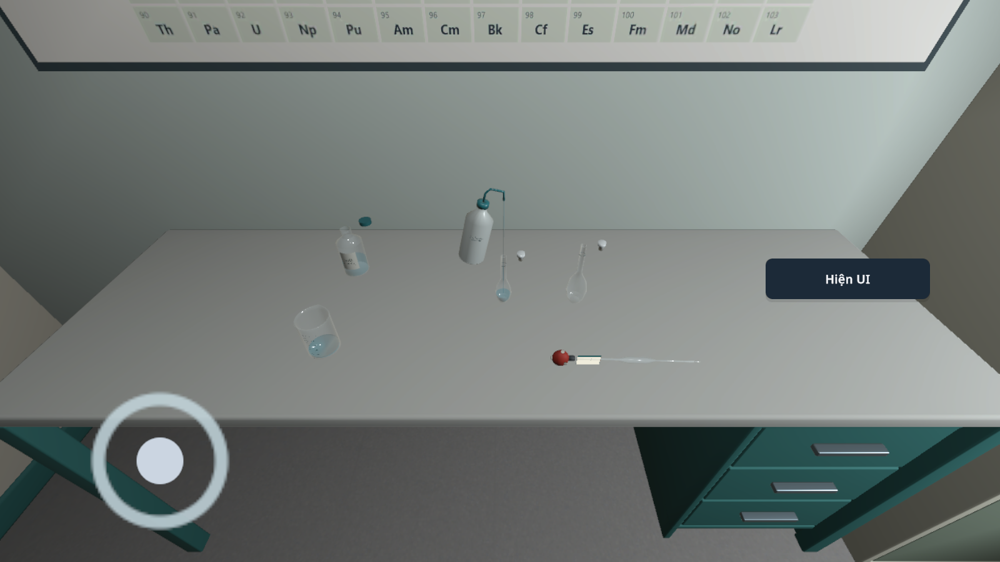

# VLAB 0.1.19 / code40 — thêm nước trực tiếp trong C05

26/10/2026. Goal đầy đủ vẫn đang mở.

Giữ bình rửa đã lắp, kéo vòi qua cổ bình định mức đang mở; nước chuyển dần theo lượng SDK chấp nhận. Thả, tạm dừng, mất đầu vào hoặc trỏ vào UI sẽ dừng dòng. Bình rửa về vị trí đỡ lúc cầm; lượng nước đã thêm được giữ lại.

Đây là lần pha ban đầu của C05. Pha nối tiếp giữ luồng nút cũ. Vòi được hỗ trợ độ cao và hướng xuống; người dùng điều khiển ngang, không có hút về tọa độ bình nhận. Tốc độ dòng và giảm tốc gần vạch là hỗ trợ thao tác, không phải phép đo áp suất hay lưu lượng đã hiệu chuẩn.

## Kiểm tra

[Log](checks.txt) gồm hồi quy SDK C01–C08, trường hợp C05 về đường nước/vật cản, lượng nước hữu hạn, phần pha dở dang, không tạo mẫu hoàn chỉnh khi khôi phục và nồng độ từ số mol/thể tích thực. Bài học kiểm tra vạch theo dải đánh dấu có sẵn trên model; đây không phải chứng nhận dụng cụ Class A.

Lượt UI dùng chạm được đưa qua Input System từ camera thực của app: cầm model, kéo tới tọa độ nằm trong màn hình, chuyển nước, bảo toàn thể tích, camera không xoay, thả dừng dòng và trả quyền sở hữu. Lắp dụng cụ/rửa pipette/chuyển aliquot ban đầu là fixture API được ghi rõ. Test bấm nút **Nhìn về bàn** trước khi thao tác, tương ứng với lựa chọn người dùng; không chỉnh camera ngầm để giả PASS.

[APK và SHA256](ARTIFACT.json) · [Build](android-build.txt) · [Chữ ký](apk-signature.txt) · [Mã nguồn](SOURCE_SHA256.json).

Unity đã biên dịch và xuất dự án Android; lần đóng gói đầu thất bại ở `packageRelease`. Sau khi chuyển các APK cũ sang kho lưu để giải phóng ổ E, chạy lại `assembleRelease --stacktrace --no-daemon` trên đúng bản xuất không đổi đã thành công. Đây là khôi phục bước đóng gói, không phải BuildReport Unity ban đầu thành công. Xem [kết quả khôi phục](package40-recovery.txt) và [kết quả Unity ban đầu](unity-build40-original-failure.txt).

## Chưa hoàn thành

Chưa có rót hóa chất bất kỳ giữa các cốc, mô hình thành phần/phản ứng cho mọi bài, vật rơi/tràn tự do, hay thao tác pha nối tiếp hoàn toàn bằng tay. Chưa kiểm tra đủ32bài qua UI trên APK, điện thoại/Cardboard/BLE thật hoặc dàn mọi công thức trong văn bản dài. Các PASS ở đây là Unity Editor, không thay nghiệm thu thiết bị.
