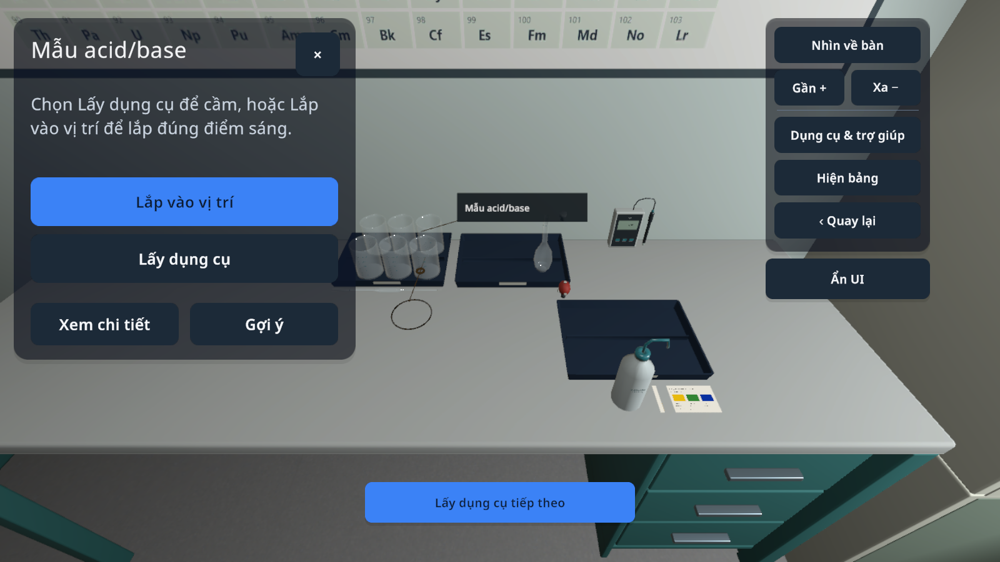

# VLAB 0.1.21 / code42 — kéo và đặt dụng cụ trên điện thoại

## Lỗi và cách sửa

Sau khi bấm lấy dụng cụ rồi nhấc tay, vị trí trỏ dự phòng tiếp tục kéo dụng cụ ra ngoài màn hình. Khoảng cách cầm cố định cũng khiến thao tác kéo không đưa vật tới đúng mặt bàn.

Ở chế độ điện thoại, vật đang cầm giữ nguyên vị trí khi không có ngón tay thao tác. Kéo một dụng cụ rời phù hợp qua mặt bàn hoặc khay sẽ đặt nó phía trên mặt đỡ hợp lệ; bấm **Đặt xuống bàn** để thả. Kiểm tra mặt đỡ, vật cản, tư thế bình và quyền sở hữu vẫn giữ nguyên. Bộ phận lắp ráp vẫn dùng **Lắp vào vị trí**; không tự hoàn thành bước thí nghiệm.

## Kiểm tra

- `phone-placement-before.txt`: tái hiện trước sửa — cốc bị kéo ra ngoài màn hình, không tìm được bề mặt mô hình để chạm.
- `phone-placement-checks.txt`: sau sửa, hành trình C06 qua cả bật và tắt joystick. Dùng sự kiện cảm ứng trong Unity để lấy, kéo, nhấc tay, bấm đặt xuống và chờ vật rơi lên mặt đỡ; không gán vị trí mô hình để giả thao tác kéo. Camera không xoay theo động tác kéo vật.
- Thiết lập bài và chọn bảng dụng cụ dùng fixture; đây không phải nghiệm thu toàn bộ C06 hay 32 bài.
- `ARTIFACT.json`, `android-build.txt`, `apk-signature.txt`: danh tính, bản đóng gói, chữ ký và SHA256 của APK tương ứng.

Điện thoại được hỗ trợ độ cao 8 cm trên mặt đỡ khi kéo dụng cụ rời phù hợp. Chưa mô phỏng ném, lật bình hoặc đổ tràn. Không thay đổi đường cầm bằng tay cầm/VR; chưa kiểm tra bản này trên Android, Cardboard hoặc BLE thật. Các giới hạn của [code41](../LearnerExperience/REPORT.md) vẫn áp dụng; chưa hoàn tất toàn bộ goal.
