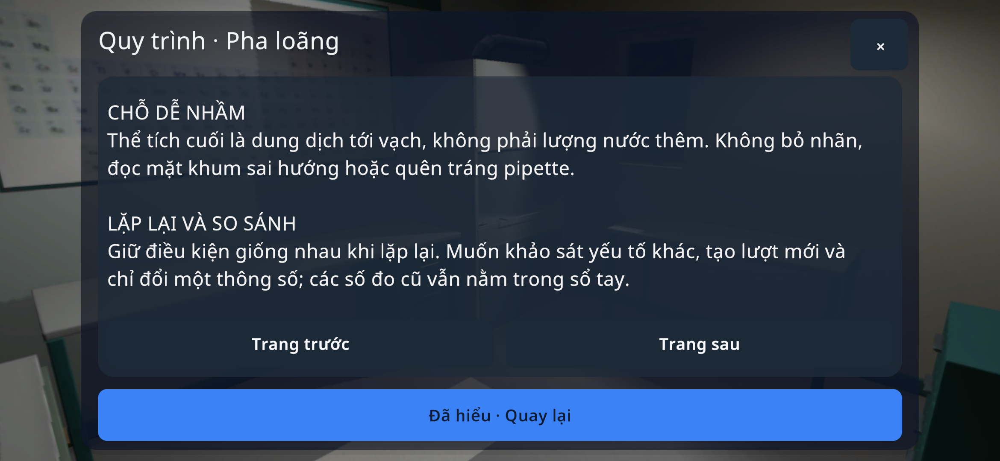

# Nội dung quy trình thực hành — sau code42

**Chỉ có trong mã nguồn sau code42; chưa nằm trong APK code42.**

Cửa sổ Quy trình trước đây hiển thị bước chuẩn bị của ứng dụng, nhưng bỏ qua `stepsVi` trong tài liệu bài học: cách lấy mẫu đo, lặp lượt, thay đổi biến và so sánh kết quả. Nay phần kế hoạch thực hành hiển thị đủ các bước này, cùng ví dụ được ghi rõ là minh họa, không phải số đo của học sinh. Bước thao tác và điều kiện hoàn thành trong ứng dụng vẫn ở phần đầu.

- Đối chiếu 32 mục trong `Catalog/experiments.json` với `research/experiments.py` từ bộ nghiên cứu được cung cấp: không có khác biệt ở các bước. Xem `procedure-source-audit.json`.
- `procedure-before.txt`: kiểm tra tái hiện thiếu bước đo/so sánh trước sửa.
- `guide-checks.txt`: đủ nội dung chuẩn bị, kế hoạch thực hành và nhãn ví dụ của cả 32 bài. Mở/đóng cửa sổ không tạo lượt đo hoặc số liệu.
- Giao diện P01/C05/B01 được kiểm tra tại 1280×720 và 2340×1080 trong Unity; kiểm tra vị trí cuộn cuối bằng API layout, nút đóng bằng sự kiện cảm ứng. Không diễn giải thành thao tác cuộn trên thiết bị thật hoặc hoàn thành 32 thí nghiệm.

Phần nghiên cứu là kế hoạch bài học; không chứng minh mọi thao tác, tùy chọn hoặc đồ thị đã có trong runtime. Các bước hóa học còn hỗ trợ và giới hạn của code42 vẫn cần xử lý riêng. Chưa kiểm tra bản thay đổi này trên Android/Cardboard/BLE thật.
