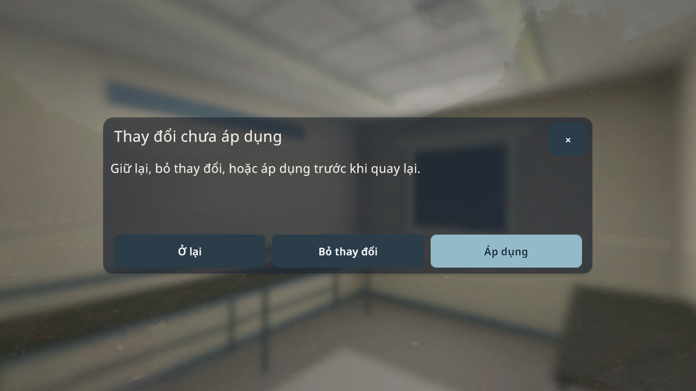
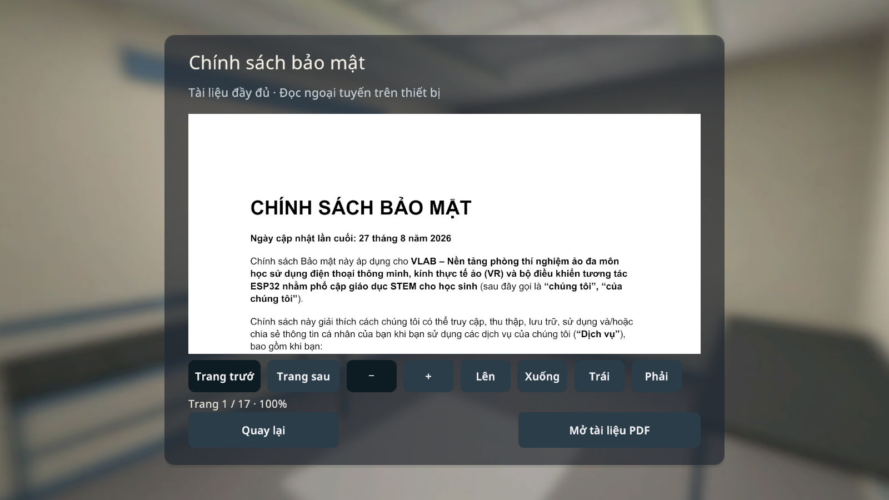
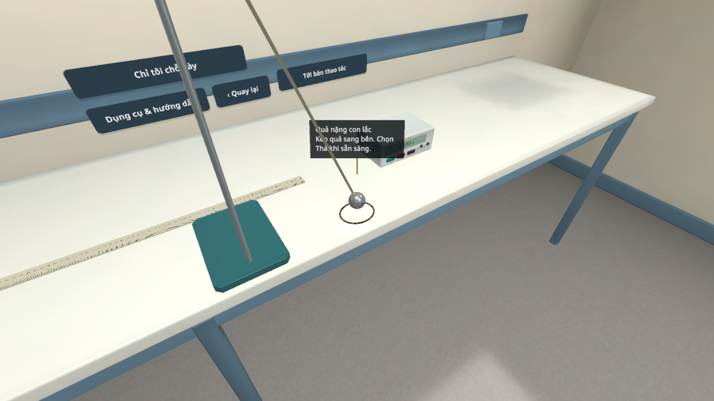
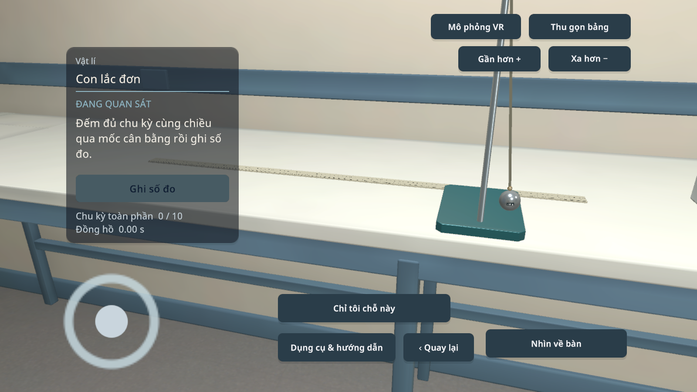

# Kiểm tra Editor — 23/10/2026

Đợt này cập nhật source sau candidate **0.1.7 / code21**. **Chưa build APK mới.** Bằng chứng dưới đây được thu trong Unity Editor 6000.6.4f1 ở project làm việc trước khi đồng bộ lên repository.

| Phạm vi | Kết quả | Bằng chứng |
|---|---|---|
| Hộp thoại và lớp nền | 36 PASS, 0 FAIL; các nhánh ở lại, bỏ thay đổi, áp dụng; 10 vòng chuyển chế độ mô phỏng | [Biên bản](dialog-checks.txt) |
| Đọc PDF Việt / Anh | 135 PASS, 0 FAIL; tải đủ 47 trang, đối chiếu SHA PDF gốc, chuyển trang, zoom và ẩn/hiện | [Biên bản](legal-checks.txt) |
| Màu tham chiếu UI | Mẫu màu flat/world trùng nhau trong Editor | Chẩn đoán trong biên bản hộp thoại; không chứng minh màu trên Cardboard native |

## Ảnh từ ứng dụng đang chạy trong Editor

## Giới hạn và chạy lại

Đây là kiểm tra callback và trạng thái UI trong Editor, không thay thế thao tác đa chạm, cảm biến điện thoại, Cardboard native, BLE hay hành trình đầy đủ của 32 thí nghiệm. Không dùng các số PASS trên làm chứng nhận sản phẩm hoàn tất.

Các entry point Editor: `FinalPassUiChecks.Run` và `FinalPassLegalChecks.Run`. Probe dùng hồ sơ QA riêng. Kết quả chạy lại được ghi vào `Evidence/FinalPass/`; không dùng hồ sơ học sinh để chạy thử. Các receipt ở trang này được giữ nguyên từ lần chạy đã ghi nhận, trước thay đổi đường dẫn đầu ra của probe.

Giữ nguyên vị trí và GUID các asset Unity. `docs/archive/README-2026-09-12.md` là tài liệu lịch sử, không phải hướng dẫn mở project hiện tại.

## Chưa phát hành — tương tác và hướng dẫn

- [34 PASS, 0 FAIL](interaction-checks.txt) qua UI thực của ứng dụng, pose XR-HMD mô phỏng qua Input System/Tracked Pose Driver và cảm ứng được đưa vào Input System. Không gán sẵn trạng thái hoàn thành.
- P01: chọn bằng gaze, kéo quả thật theo ràng buộc chiều dài, chọn Thả; kéo/thả bằng cảm ứng. P02: cầm và hủy. C04: chọn/cầm ống nhỏ giọt và hủy khi mở UI. B01: ba thao tác chuẩn bị riêng. M01: chọn motor để chạy. Đây là phạm vi một phần của năm bài, không phải 32 hành trình hoàn chỉnh.
- Gợi ý tại dụng cụ: nhãn tối giản sau khi chờ, chỉ dẫn mở rộng khi mắc kẹt hoặc sau ba lần sai; thao tác đúng đặt lại mức hỗ trợ. Ô chữ tính đủ khoảng đệm, kiểm tra không cắt chữ.
- Hồi quy hộp thoại trên source cuối: [36 PASS, 0 FAIL](dialog-checks.txt). Sửa cleanup Game View QA để bỏ đúng mục do test tạo; không xóa các mục của người dùng.
- [Hash source tại checkpoint](interaction-source-sha256.json). Chưa có APK mới; Android/Cardboard/BLE phần cứng và kiểm thử đầy đủ 32 bài vẫn chưa đạt nghiệm thu.

## Góc nhìn điện thoại và lượt kiểm tra 32 bài

- [37 PASS, 0 FAIL](visibility-checks.txt) trong probe tương tác/góc nhìn: quả lắc tại viewport 1600 × 900 tăng từ khoảng 17 lên 67 pixel khi tự căn góc theo bước. Không đổi tỉ lệ model; camera giữ vị trí khi đang kéo. Không ép di chuyển origin VR trong fixture XR mô phỏng.
- [Ma trận 32 bài](journeys32-matrix.md) · [Receipt JSON](journeys32-matrix.json): 26 bài lưu và mở lại kết quả, 6 bài bị chặn, không có runtime error được probe ghi nhận. Có hỗ trợ chuẩn bị trong một số bài; kết quả này không xác nhận toàn bộ hành trình tự thao tác của 32 bài.
- C01 vướng điều hướng trang dụng cụ của test; C04 vướng điều kiện điều hướng trong runner; C07 dừng ở nút ghi chưa bật, cần tái hiện. B01/B02/B08 hết thời gian kiểm tra/phân loại bằng mắt. Chưa đủ bằng chứng để quy tất cả blocker này thành lỗi ứng dụng.
- Kiểm tra riêng còn **FAIL** đường viền cho dụng cụ chỉ có LineRenderer. Các lỗi và giới hạn này vẫn mở, không bị loại khỏi báo cáo để đổi kết quả thành PASS.
- Receipt giữ nguyên kết quả; riêng đường dẫn tuyệt đối đến hồ sơ QA được thay bằng `<isolated QA profile>` khi đưa vào tài liệu công khai. Không có hồ sơ người học trong repo.

[SHA256 source tại checkpoint](visibility-source-sha256.json). Đây là các lần chạy Editor đã hoàn tất, không phải kết quả Android/Cardboard/BLE phần cứng hay APK mới.
