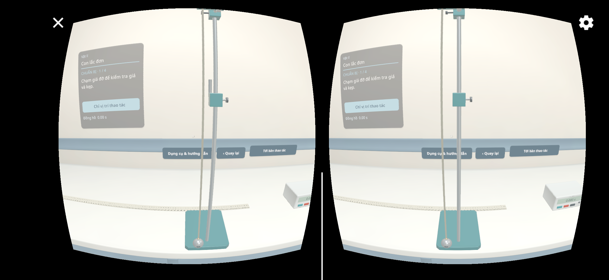
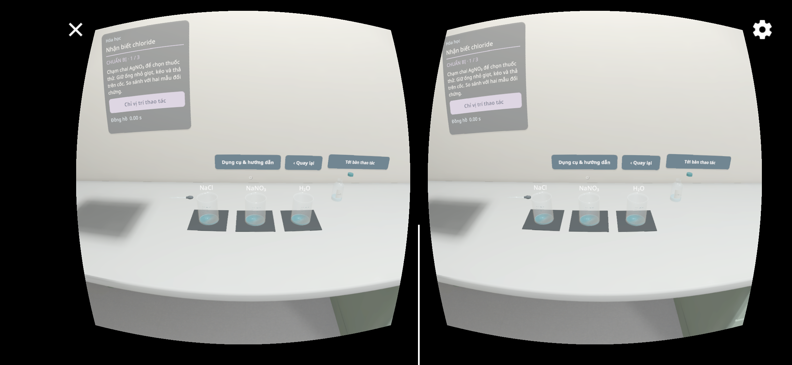
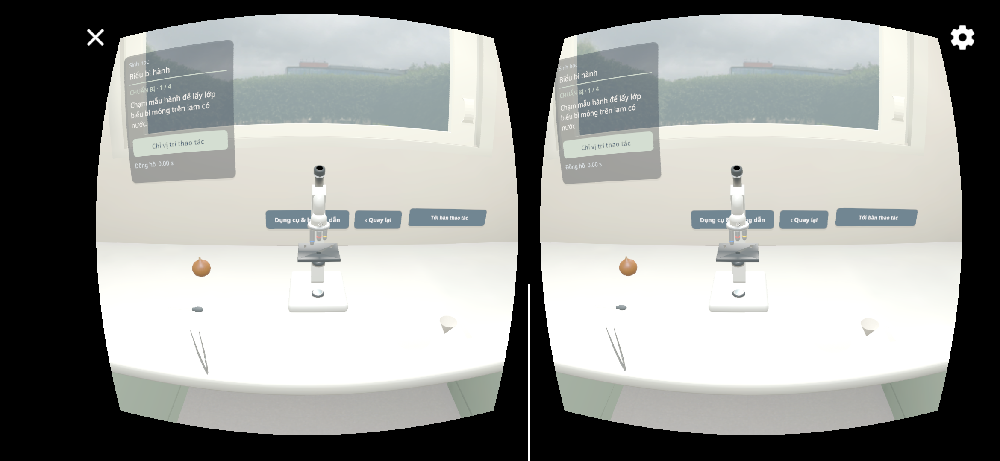
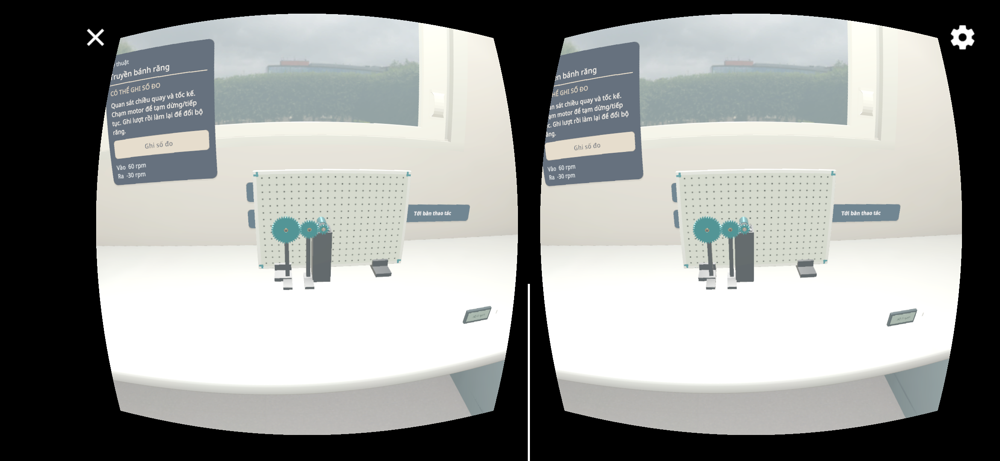
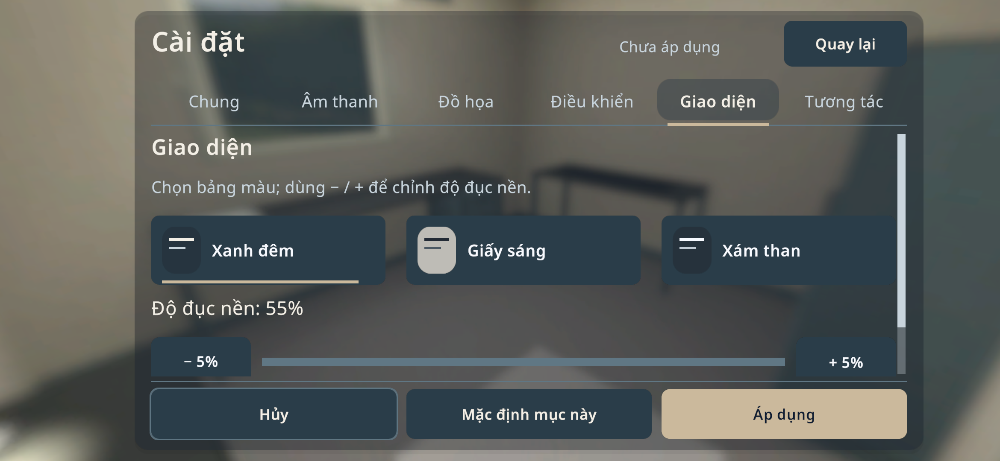
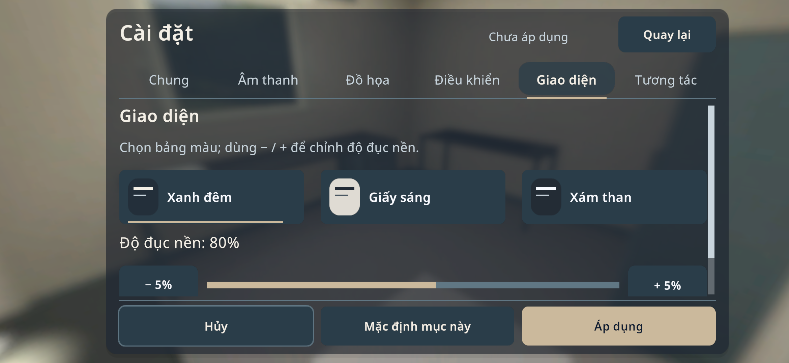
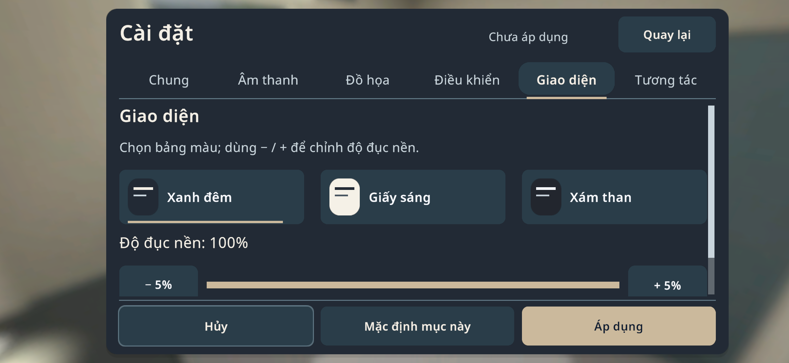
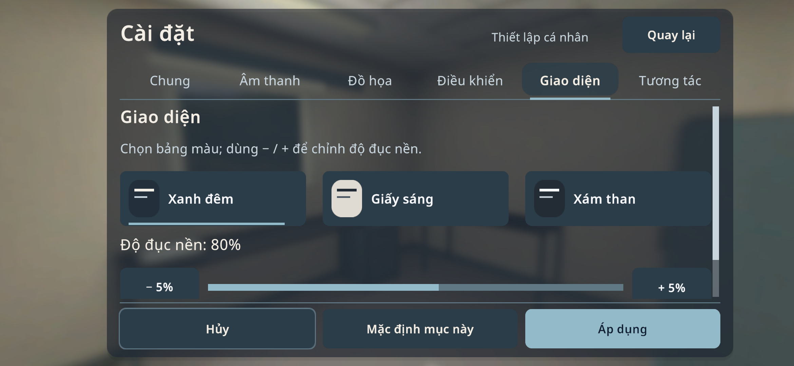

# Prototype 0.1.7 / code21

Mốc bằng chứng: **21/10/2026**. Tài liệu đóng gói lại ngày **22/10/2026**; không có lượt build hoặc kiểm thử runtime mới chỉ để cập nhật README.

## Nhận diện bản đã build

| Thuộc tính | Giá trị |
|---|---|
| Tệp APK | `VLAB-0.1.7-VR-workstation-code21.apk` |
| Version name / code | `0.1.7` / `21` |
| Package / nhãn ứng dụng | `com.nguaman.vlab` / `VLAB` |
| Kích thước | 124.378.785 byte |
| SHA-256 | `5A84A18A5E99CAAEF226027D02F16E6CCAFFD80D6A11A9AD226F8F90880A34E9` |
| Android | API26+; target36; ARMv7 và ARM64 |

Xem [manifest của artifact](ARTIFACT.json). Candidate này được lưu và bàn giao riêng, **chưa upload lên GitHub Releases**. [Releases](https://github.com/thieen209/VLAB/releases) vẫn có bản 0.1.4/code5 tại lần cập nhật tài liệu này. APK tự build lại có thể khác hash và chữ ký; manifest trên nhận diện artifact đã thử, không phải cam kết mọi lần build cho ra cùng byte.

## Thay đổi chính

- VR tới sát bàn thao tác theo bounds bàn thật; nút **Tới bàn thao tác** đưa người học về vị trí làm việc. Head pose vẫn do Cardboard điều khiển; không dùng FOV/world-scale để thay cho việc tới gần.
- Có nút vào VR trực tiếp trên giao diện thí nghiệm của điện thoại. Panel thao tác và modal được đưa ra trước để tránh hình học phòng che nút.
- Opacity/theme preview dùng giá trị đang chỉnh; Apply lưu, Cancel khôi phục giá trị đã lưu. Nút và chữ vẫn giữ nền đọc được.
- Trigger Cardboard duy trì trạng thái giữ/thả sau press được SDK cho phép. Gaze ban đầu trên trang mới không tự kích hoạt chuỗi điều hướng ngay.
- Mặt bàn đổi sang vật liệu sáng; chân/tủ giữ riêng. Các khay trang trí đã nhận diện được tắt bằng instance, không xóa dụng cụ nguồn hay cân đang dùng cho bài khác.

## Kết quả đã ghi nhận

| Kiểm tra | Kết quả và giới hạn |
|---|---|
| Build APK | Thành công; 0 lỗi / 42 cảnh báo |
| Editor component/geometry | [42 PASS / 0 FAIL](checks.txt); không phải toàn bộ 32 bài end-to-end |
| Native Android emulator | Cài cập nhật code21, vào stereo P01/C04/B01/M01; đây là một giả lập API35 với ARM translation, không phải điện thoại thật |
| M01 | SDK trigger chạy motor; số đọc 60rpm đầu vào / -30rpm đầu ra |
| Opacity trên điện thoại | 55/80/100 thay đổi thấy được; Apply rồi restart giữ 80%; Cancel draft55 khôi phục80 |
| Dữ liệu cũ | [14 lượt và nội dung sổ tay giữ nguyên](profile-retention.json); không đưa profile riêng vào repository |
| B01 | [Audit ray](B01-final-ray-audit.txt): không bị UI chặn trong trường hợp hình học Editor đã kiểm tra; thị kính nhận ray đúng, bốn ray tới tâm ốc chạm Stage trước. Không coi đó là PASS thao tác ốc/native kéo-thả |
| Decor | [Audit instance](decor-instance-audit.txt): 20 phần khay/rim đã nhận diện inactive. Đúng vật cân trong ảnh cũ chưa được đối chiếu chắc chắn |

Xem [checklist từng Settings](SETTINGS-LEDGER.md). Các mục UNTESTED/BLOCKED không được tính là PASS.

## Ảnh từ APK trên giả lập

Ảnh giữ nguyên, không dựng lại hoặc sửa camera để giả bằng chứng sensor.

| P01 — Con lắc đơn | C04 — Nhận biết chloride |
|---|---|
|  |  |

| B01 — Biểu bì hành | M01 — Bộ truyền bánh răng đang chạy |
|---|---|
|  |  |

| Opacity55% | Opacity80% | Opacity100% |
|---|---|---|
|  |  |  |

## Chưa được chứng minh

Chưa có kiểm thử code21 trên điện thoại/headset/BLE thật, toàn bộ Settings, kéo/giữ/thả VR đầy đủ hoặc 32 bài end-to-end. Góc quan sát/ốc lấy nét B01 còn cần kiểm tra thực tế. Ảnh preview phòng cũ chưa được chụp lại. Không gọi prototype này là bản production hoàn thiện chỉ dựa vào Editor hoặc giả lập.
