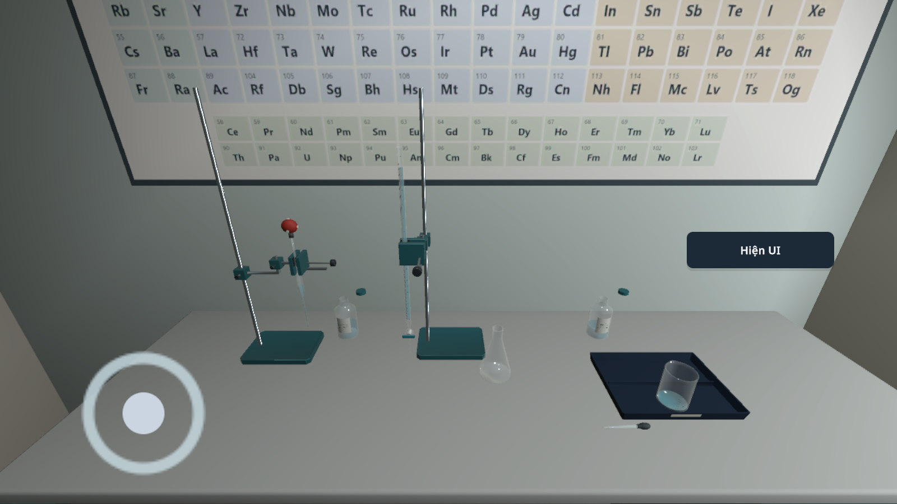

# VLAB 0.1.22 / code43 — pipette chuẩn độ và quy trình đầy đủ

## Thay đổi

- Bài chuẩn độ: sau khi chuẩn bị burette và đọc mặt khum đầu, giữ pipette/quả bóp để hút mẫu, chuyển tổng 10 mL sang cốc thải để tráng, rồi hút và chuyển 10 mL mẫu mới vào bình chuẩn độ. Nút chuẩn bị không còn tự tráng và tạo phần mẫu.
- Có giá và kẹp riêng bằng mô hình gốc cho pipette; kẹp burette không bị sử dụng chung. Thả tay đóng van và đặt pipette vào kẹp riêng, giữ phần mẫu đang có. Vị trí giá tách khỏi vùng làm việc của bình chuẩn độ.
- Kiểm tra chai mở, dung tích thực, đầu pipette nằm trong nguồn/bình nhận, lượng mẫu hữu hạn và phần đã chuyển. Các lượt chuẩn độ tiếp theo cũng cần tráng/chuyển lại; hỗ trợ tự đặt vị trí vẫn là lựa chọn có nhãn riêng.
- Cửa sổ quy trình có thêm bước đo, lặp lượt và so sánh từ tài liệu 32 bài; ví dụ được tách rõ khỏi số đo học sinh. Xem [đối chiếu nguồn và kiểm tra giao diện](../ProcedureCoverage/REPORT.md).

## Bằng chứng

- `titration-pipette-before.txt`: tái hiện bước chuẩn bị tự tráng/chuyển mẫu trước sửa.
- `titration-pipette-checks.txt`: kiểm tra dữ liệu và giá đỡ; hành trình cảm ứng C01 hút một phần, thả, cầm lại, tráng rồi chuyển mẫu; kiểm tra lại hành trình C05 và bình rửa. Cảm ứng được đưa qua Input System trong Unity, không gán vị trí dụng cụ cho hành trình kéo.
- `chemistry-integration-checks.txt`: kiểm tra SDK của 8 bài Hóa, gồm chuỗi ba lượt chuẩn độ. Đây là fixture và API, không phải hoàn thành 8 bài qua UI.
- Lắp bộ dụng cụ, chuẩn bị burette và đọc mặt khum ban đầu trong bài kiểm tra giao diện là fixture; không tuyên bố đã kiểm thử tương tác các bước đó.
- `android-build.txt`, `apk-signature.txt`, `ARTIFACT.json`: thông tin đóng gói, chữ ký và định danh file APK.

## Giới hạn còn lại

Điện thoại có hỗ trợ độ cao và tư thế pipette; tốc độ hút/chuyển 3 mL/s chỉ phục vụ tương tác. Chưa mô phỏng thủy động lực đầy đủ, tràn hoặc ném. Phần chuẩn bị C01 đang làm dở bắt đầu lại khi mở lại bài; các lượt đã ghi vẫn được lưu. C05 vẫn có khôi phục phần dung dịch dở dang như trước. Không gọi việc nhấc tay/đặt vào kẹp là bằng chứng đã lưu phần mẫu qua lần đóng ứng dụng.

Nạp burette và thêm chỉ thị trong C01 vẫn là bước hỗ trợ; các đường chuyển hóa chất ngoài phần được nêu chưa hoàn thiện. Chưa kiểm tra APK này trên điện thoại/Cardboard/BLE thật; chưa kết luận toàn bộ goal đã hoàn thành.
