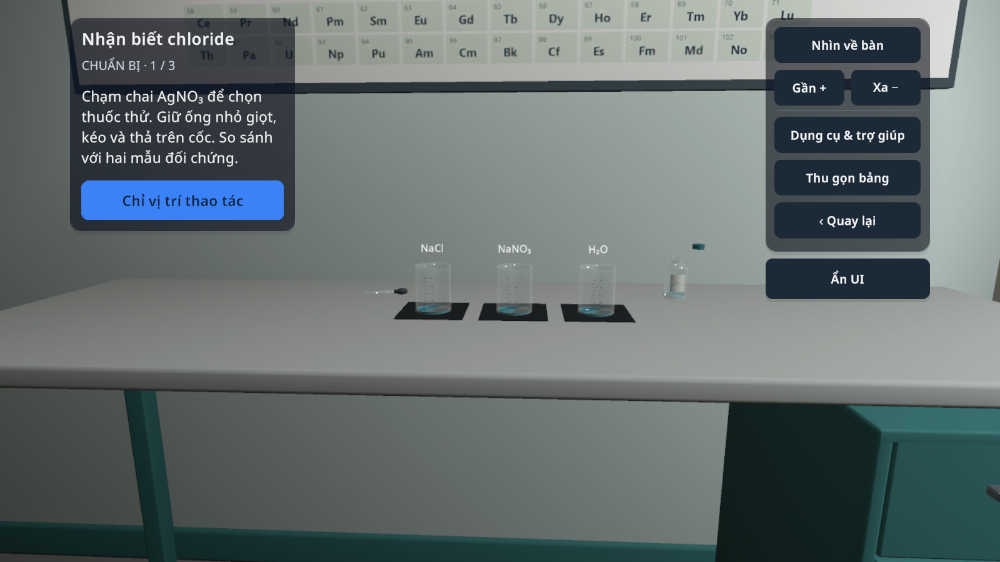
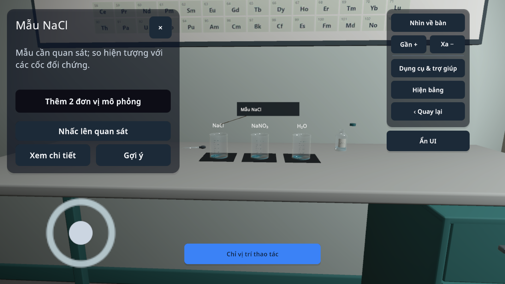
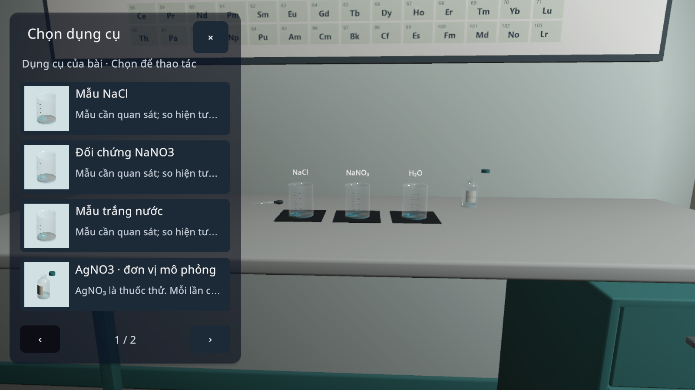
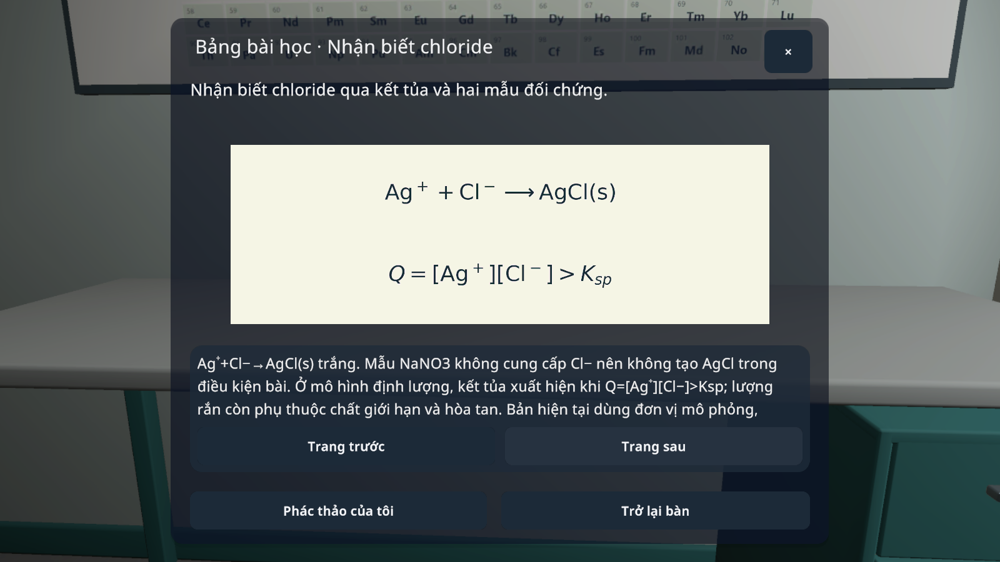
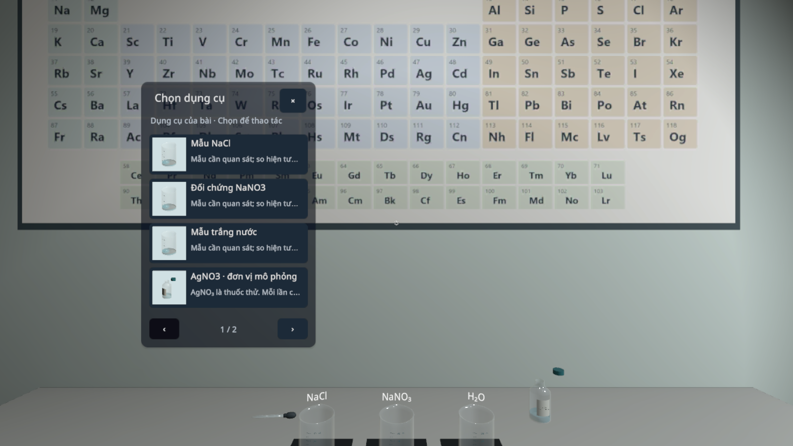

# VLAB 0.1.12 / code32 — bàn giao 24/10/2026

## Thay đổi

- Chọn dụng cụ theo bài qua thumbnail dựng từ chính mesh/material đang dùng, cache trong phiên ngoại tuyến. Bảng chọn đóng sau khi chọn; bảng thao tác gọn bên cạnh bàn. Thông tin dài chỉ mở khi yêu cầu.
- Sửa thao tác chạm bị luồng chuột hủy; giữ dụng cụ sau khi nhả nút Lấy; bổ sung vùng collider còn thiếu. Camera hỗ trợ không tự xoay giữa một thao tác cảm ứng.
- Thêm kéo đầu dò đến cốc ở C06; kéo lực kế và đổi sang kéo đều ở P03; kéo đầu dây ròng rọc ở M03. Các thao tác gọi SDK hiện có, không tạo số đo giả. Các công cụ đủ điều kiện có thể nhấc, xoay và đặt lại đúng vị trí để quan sát. Không tuyên bố tất cả32 bài là mô phỏng vật lí cầm nắm tự do.
- Hint dùng trạng thái bài/dụng cụ, giảm sau tiến bộ, tăng khi chờ/sai/yêu cầu; tắt hint không còn vẽ cue. Gợi ý không tự hoàn thành thí nghiệm.
- Bảng bài học lấy mục tiêu, ảnh công thức và nội dung từ nguồn đã có cho32 bài; giữ trang phác thảo. Chỉ số/điện tích trong phần chữ dùng rich text. Phần giải thích sâu hiện vẫn là nguồn tiếng Việt khi chọn English.
- Tour ngắn, bỏ qua từng bước hoặc thoát, ghi nhớ lựa chọn và mở lại trong Trợ giúp. Khoanh nút hiện hành, làm tối phần còn lại nhưng không chặn input. Màn chọn bài bỏ chữ trạng thái rỗng lặp lại và nút ôn bài phụ; sổ tay vẫn ở menu/trạm.
- Giảm lớp đen menu, nâng ambient nhẹ; thêm âm tiếp xúc/đặt dụng cụ, chất lỏng và cơ cấu theo hành động thành công. Âm tổng hợp cục bộ, có vị trí trong cảnh, tuân theo âm lượng/tắt tiếng. Đây không phải thu âm dụng cụ thật; các hiệu ứng mô hình khoa học hiện có được giữ.
- Giữ bản tích hợp hai tay V6 đã có trước phiên này. [Contract](CONTROLLER-V6-PROTOCOL.md), [bản sửa controller trước](CONTROLLER-V6-PRIOR-FIXES.md). Không đổi firmware/GPIO/UUID.

## Kiểm tra

- [32 bài: ma trận UI](ui-matrix.csv) tổng hợp các checkpoint kế tiếp: vào bài, lấy/chọn dụng cụ, preview thật, đóng modal, bảng công thức, giữ phác thảo, tắt hint. Đây là smoke UI, không phải32 lượt hoàn thành độc lập trên APK cuối.
- [Ba luồng thao tác mới](gesture-checks.txt): C06/P03/M03 đi đến đo, bấm ghi kết quả và làm lại giữ sổ. Dựng bộ dụng cụ ban đầu bằng API được đánh dấu riêng; thao tác kéo và nút ghi là sự kiện touchscreen qua ứng dụng.
- [Lượt hồi quy cuối](final-focused-checks.txt): tour từ lựa chọn đến thao tác thực, chạm đồng thời có chuột, C04, viewport1280×720/2340×1080/2048×1536, bố cục world-space rồi trở lại phone, controllerV6 bằng packet giả lập, phone/gamepad, waveform không clipping và master mute.
- SDK fixture: [Vật lí/Kỹ thuật15 bài](physics-mechanics-sdk-checks.txt), [Hóa học8 bài](chemistry-sdk-checks.txt), [Sinh học8 bài](biology-sdk-checks.txt). P02 dùng sàn nhận vật trong fixture độc lập, không chứng minh giới hạn phòng thật.
- Lỗi test fixture đã được tách khỏi lỗi sản phẩm: suite khoa học phải chạy trong scene cô lập; bộ so sánh controller phải dùng camera fixture tại gốc như runner gốc. Không sửa thuật toán controller để làm test xanh.

## Ảnh runtime

| Trước | Sau |
|---|---|
|  |  |

## APK và giới hạn

Bản thử nghiệm code32 được phát hành qua GitHub Releases; không thêm APK mới vào source. Xem `ARTIFACT.json` cho kích thước, SHA256 và cấu hình APK. Source của APK là commit được gắn tag phát hành; build chỉ thay version/signing settings rồi khôi phục.

Chưa có điện thoại/ADB, kính Cardboard hoặc tay cầm BLE thật kết nối trong phiên. Chưa xác minh head tracking, độ trễ, chất lượng nghe trên loa điện thoại, công thái học/hiệu năng Android. Không dùng kết quả Editor thay cho các phần này. Controller vẫn giữ giới hạn F06/F07 ghi trong bàn giao trước. Chưa làm lại nội dung khoa học hoặc toàn bộ lighting bake; không tuyên bố hết mọi lỗi cũ.
